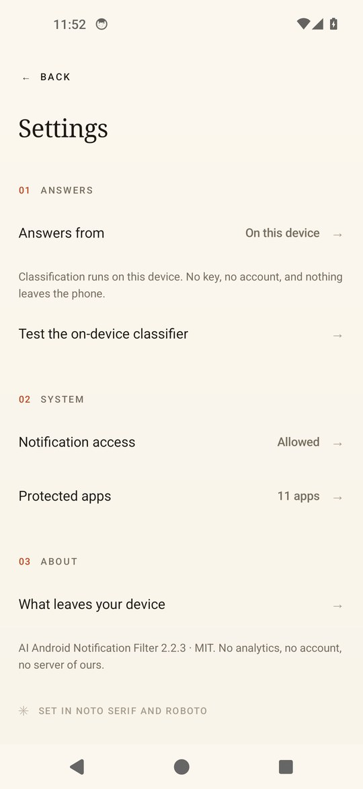

# NotifyCleaner

Dismisses junk notifications on your phone. An 18 KB classifier runs inside the app — no account,
no API key, no analytics, no third-party SDKs. The default setup makes no network request at all; a
cloud model is available in Settings if you ever want it, and it is off by default.

**[Download the APK](https://github.com/shreyash-sharma-byte/ai-android-notification-filter/releases/latest)** ·
[Privacy](docs/PRIVACY.md) · [Architecture](docs/ARCHITECTURE.md) · [Publishing](docs/PLAY.md)

<p align="center">
  
  
  
</p>

*Screenshots show an earlier build; they will be re-captured before the Play and F-Droid release.*

Most "notification cleaners" read your notifications on someone else's server, or sell you the
notifications they claim to clean. This one asks a single question — *is this junk?* — and answers it
locally, then throws the text away.

## How it decides

Every notification is judged on its own, cheapest test first:

1. **A gate that is not a judgement.** Calls, alarms, media, navigation, downloads, group summaries,
   anything non-dismissible, and chat, mail and calendar notifications are never classified at all.
   Neither is anything from an app on your protected list.
2. **Five guard rules** protect what must never be dismissed: one-time codes, money movements,
   order and delivery state, security events, account deadlines. A rule hit means KEEP, before any
   model is consulted — on both engines, and before any text can be sent to a provider.
3. **An 18 KB linear model** over TF-IDF word unigrams and bigrams, trained on labelled
   notifications, scores what is left.
4. **The sender.** Apps are recognised as well as read. A notification from a shop, food-delivery
   or travel app is dismissed on its score alone — "Big Billion Days are live" contains no offer
   wording, and no text rule will ever catch it — while a social app that also carries direct
   messages gets no such benefit. Chat, mail, calls, codes and banking apps are protected by
   default, so they are never classified at all.
5. **An evidence gate.** For everything the sender does not explain, a positive score is not proof
   of an advert — it is proof that the text shares words with promotional writing, and ordinary
   English shares plenty. The text must also contain the language of an offer (a percentage,
   "shop now", "cashback", two of "sale/offer/deal/limited"…).
6. **An uncertainty band.** A score close to the threshold, with promotional language but no
   confidence, is KEPT and recorded as unsure rather than guessed.

Anything unrecognised, any failure and every uncertain answer **keeps** the notification. What was
removed is listed in the app, so a wrong call is always visible, and any removed row can protect its
app with one tap. The classifier's own record — including what it still gets wrong — is in
[docs/CLASSIFIER.md](docs/CLASSIFIER.md).

## Why not a language model

The obvious approach is a small LLM. It was benchmarked against the classifier that predates the
evidence gate, on 100 hand-labelled notifications, and lost on the metric that matters — real
notifications destroyed:

| Model | Size | Promotions removed | Real notifications destroyed |
|---|---|---|---|
| gemma3:270m | 291 MB | 0 / 47 | 0 — it kept everything |
| smollm2:360m | 725 MB | 0 / 47 | 0 — it kept everything |
| qwen3:0.6b | 522 MB | 31 / 47 | **22**, including an OTP and a SIP debit |
| this classifier, before the evidence gate | **18 KB** | 39 / 47 | 1, an arguable cashback reward |

Two models were too weak to classify and one was strong enough to be dangerous. A linear model over
the same text was both useful and safe, in a five-hundredth of the memory.

That table is a historical comparison and its harness is not in this repository. The measurements
that describe what ships today — the corpora, the before/after numbers and the method — are in
[docs/CLASSIFIER.md](docs/CLASSIFIER.md), and the test corpus is in `test/LogicTest.java`.

## Privacy

Nothing leaves the phone unless you explicitly configure a provider, which requires a second,
provider-specific disclosure. There is no telemetry, no crash reporting, no advertising ID.

The app declares one Android permission — `INTERNET` — and exercises it only on the optional
provider path. Notification access is not an app permission: it is the service's
`android:permission`, held by the system. You grant it in Android's own settings and can revoke it
there at any time.

## Build

No Gradle, no Android Studio. A JDK and the Android SDK command-line tools, nothing else.

```bash
./test.sh     # 440 plain-JDK assertions — the logic harness needs no Android
./build.sh    # aapt2 → javac → d8 → zipalign → apksigner
```

`build.sh` refuses to produce an APK if the tests fail. `tools/install-sdk.sh` fetches a root-free SDK.

## Licence

MIT. See [LICENSE](LICENSE).
