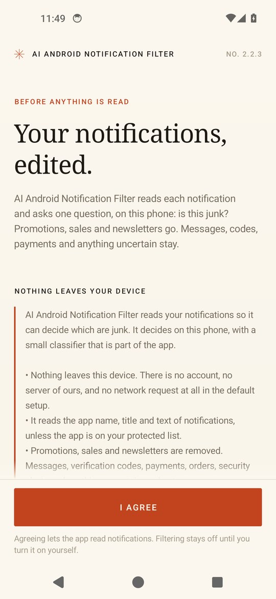
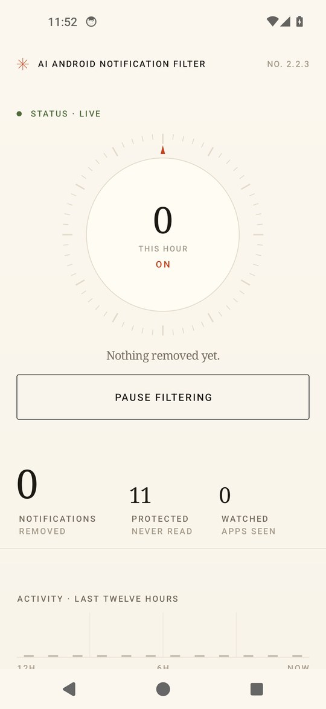

# AI Android Notification Filter

Dismisses junk notifications on your phone. An 18 KB classifier runs inside the app — no account,
no API key, no network, no analytics, no third-party SDKs. A cloud model is available in Settings if
you ever want it, and it is off by default.

**[Download the APK](https://github.com/shreyash-sharma-byte/ai-android-notification-filter/releases/latest)** ·
[Privacy](docs/PRIVACY.md) · [Architecture](docs/ARCHITECTURE.md) · [Publishing](docs/PLAY.md)

<p align="center">
  
  
  
</p>

Most "notification cleaners" read your notifications on someone else's server, or sell you the
notifications they claim to clean. This one asks a single question — *is this junk?* — and answers it
locally, then throws the text away.

## How it decides

Every notification is judged on its own, in three layers, cheapest first:

1. **Five guard rules** protect what must never be dismissed: one-time codes, money movements,
   order and delivery state, security events, account deadlines. A rule hit means KEEP, before any
   model is consulted.
2. **An 18 KB linear model** over TF-IDF word unigrams and bigrams, trained on labelled
   notifications, decides the rest.
3. **Nothing else.** No cloud call, no second opinion, no retry.

Anything the model does not recognise, any failure, and every uncertain answer **keeps** the
notification. Only a clear `JUNK` dismisses. What was removed is listed in the app, so a wrong call is
always visible, and any removed row can protect its app with one tap.

## Why not a language model

The obvious approach is a small LLM. It was benchmarked against this classifier on 100 hand-labelled
notifications and lost on the metric that matters — real notifications destroyed:

| Model | Size | Promotions removed | Real notifications destroyed |
|---|---|---|---|
| gemma3:270m | 291 MB | 0 / 47 | 0 — it kept everything |
| smollm2:360m | 725 MB | 0 / 47 | 0 — it kept everything |
| qwen3:0.6b | 522 MB | 31 / 47 | **22**, including an OTP and a SIP debit |
| this classifier | **18 KB** | 39 / 47 | 1, an arguable cashback reward |

Two models were too weak to classify and one was strong enough to be dangerous. A linear model over
the same text was both useful and safe, in a five-hundredth of the memory. The full harness is in
`~/tmp/ncfilter-bench` and the methodology is described in [docs/ARCHITECTURE.md](docs/ARCHITECTURE.md).

## Privacy

Nothing leaves the phone unless you explicitly configure a provider, which requires a second,
provider-specific disclosure. There is no telemetry, no crash reporting, no advertising ID. The APK
requests exactly one permission: `BIND_NOTIFICATION_LISTENER_SERVICE`, which you grant in Android's
own settings and can revoke there at any time.

## Build

No Gradle, no Android Studio. A JDK and the Android SDK command-line tools, nothing else.

```bash
./test.sh     # 280 plain-JDK assertions — the logic harness needs no Android
./build.sh    # aapt2 → javac → d8 → zipalign → apksigner
```

`build.sh` refuses to produce an APK if the tests fail. `tools/install-sdk.sh` fetches a root-free SDK.

## Licence

MIT. See [LICENSE](LICENSE).
